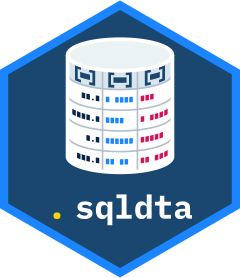

# sqldta 

`sqldta` is a Stata command that loads a table or view from Microsoft SQL Server into a Stata frame, with the value labels, variable labels, display formats, notes and data label that are kept for it in a label table in the same database. Its `if` qualifier takes a Stata expression, which `sqldta` translates to SQL, so that only the rows that meet it are read from the server.

`help sqldta` is the full reference. The [setup guide](docs/setup.md) is for whoever installs `sqldta` for a site or for their own use.

## Getting started

Where `sqldta` has been set up, choose **User > Access server data** in Stata, or type `db sqldta`, to open the dialog. It lists the servers, databases, schemas, tables and views, describes the table chosen, and builds the command, which its Copy button copies for a do-file.

In the Command window or a do-file:

```stata
sqldta, database(MyDatabase) dataset(MyTable) frame(adm)
frame change adm
```

This loads `MyTable` into a new frame, `adm`, with every label and note that the label table holds for it. `sqldta` does not change the current frame, so `frame change` moves to the frame loaded. Without `frame()`, `sqldta` loads into the current frame. A frame that already holds data is replaced only with `clear`:

```stata
sqldta, database(MyDatabase) dataset(MyTable) frame(adm) clear
```

A table in another schema is named with it, as in `dataset(staging.MyTable)`; without one, the table is in the site's default schema, usually `dbo`. The server is the site's default unless `server()` names another.

When it finishes, `sqldta` displays one line with the number of observations and variables loaded, the frame, and the number of labels and notes applied.

## Choosing columns

`sqlselect()` loads only the columns named, in the order given. Names are matched without regard to case, and the wildcards `*` and `?` work as in Stata's own variable lists:

```stata
sqldta, database(MyDatabase) dataset(MyTable) frame(adm) sqlselect(id sex age diag*)
```

`diag*` matches every column whose name starts with diag. A column is loaded under the name as typed, and `lowercase` renames every variable to lower case.

## Choosing rows

### The if qualifier

The `if` qualifier takes a Stata expression. The rows loaded are the rows that loading the whole table and then typing `keep if` would leave, so a missing value counts as greater than every number, as it does in Stata:

```stata
sqldta if sex == 1 & age >= 65 & !missing(age), database(MyDatabase) dataset(MyTable) frame(adm)
```

Without `!missing(age)`, the rows where `age` is missing would be loaded too. Strings are compared with regard to case. Dates are compared with `td()` and date-times with `tc()`, and `dofc()` gives the date of a date-time:

```stata
sqldta if admdate >= td(01jul2024) & inlist(region, "North", "South"), database(MyDatabase) dataset(MyTable)
sqldta if admitted >= tc(01jul2024 00:00) & admitted < tc(01aug2024 00:00), database(MyDatabase) dataset(MyTable)
sqldta if year(dofc(admitted)) == 2024, database(MyDatabase) dataset(MyTable)
```

The `if` qualifier supports column names, numbers, strings in double quotes, the missing value `.`, the operators `==`, `!=`, `<`, `<=`, `>`, `>=`, `&`, `|` and `!`, parentheses, and the functions `missing()`, `inlist()`, `inrange()`, `substr()`, the string case and trim functions, `year()`, `month()`, `day()`, `td()`, `tc()` and `dofc()`. Anything else, arithmetic included, stops `sqldta` with a message that points to `sqlwhere()`.

### sqlwhere()

`sqlwhere()` takes a condition in SQL Server's own language, T-SQL, as it would be written after `WHERE`, for anything the `if` qualifier does not support. The examples below are for a table of hospital admissions, `MyTable`, whose columns `diag1` to `diag20` hold ICD-10-AM codes written with their dots, such as `I21.4`.

A code and its subcodes, an exact code, and a range of codes:

```stata
sqldta, database(MyDatabase) dataset(MyTable) sqlwhere(diag1 LIKE 'I21%')
sqldta, database(MyDatabase) dataset(MyTable) sqlwhere(diag1 = 'I21.4')
sqldta, database(MyDatabase) dataset(MyTable) sqlwhere(diag1 >= 'C00' AND diag1 < 'C98')
```

Strings in T-SQL are in single quotes. In `LIKE`, `%` stands for any characters, `_` for one, and `[0-4]` for one of a range, so `'I21%'` matches I21 and every code that starts with it, such as I21.4. T-SQL compares strings by the database's collation, which for the databases that `sqldta` supports ignores case, and `=` ignores trailing spaces. The `if` qualifier can select the first of these too, as `if substr(diag1, 1, 3) == "I21"`, but compares with regard to case, as Stata does, and on a large table it is slower, because SQL Server cannot use an index for it.

A code in any of the diagnosis columns:

```stata
local list (diag1)
forvalues i = 2/20 {
    local list `list', (diag`i')
}
sqldta, database(MyDatabase) dataset(MyTable) ///
    sqlwhere(EXISTS (SELECT 1 FROM (VALUES `list') AS d(code) WHERE d.code LIKE 'E1[0-4]%'))
```

The loop writes the list `(diag1), (diag2), ..., (diag20)`, which `VALUES` turns into a column, `code`, of the twenty codes of each row, and `EXISTS` keeps the rows in which any of them starts with E10 to E14.

Arithmetic, which the `if` qualifier does not support:

```stata
sqldta, database(MyDatabase) dataset(MyTable) sqlwhere(DATEDIFF(day, admdate, sepdate) > 30)
```

`DATEDIFF(day, admdate, sepdate)` is the number of days from `admdate` to `sepdate`. In T-SQL a comparison with a missing value, NULL, is never true, so this leaves out the rows in which either date is missing; the Stata equivalent is `keep if sepdate - admdate > 30 & !missing(admdate, sepdate)`. The `if` qualifier follows Stata's rule instead, in which a missing value is greater than every number.

A date in T-SQL, against a date-time column:

```stata
sqldta, database(MyDatabase) dataset(MyTable) sqlwhere(admitted >= '20230115' AND admitted < '20230116')
```

A date written `'YYYYMMDD'` is read the same way whatever the language of the login, whereas `'2023-01-15'` may be read with the day and month swapped for a `datetime` column. The `if` qualifier does the same with `if admitted >= tc(15jan2023 00:00) & admitted < tc(16jan2023 00:00)`.

The `if` qualifier and `sqlwhere()` together, in which case a row is loaded only if it meets both:

```stata
sqldta if age >= 65 & !missing(age), database(MyDatabase) dataset(MyTable) sqlwhere(diag1 LIKE 'J1[0-8]%')
```

A subquery, here every admission of the people who have ever had an admission with I21 as the first diagnosis:

```stata
sqldta, database(MyDatabase) dataset(MyTable) ///
    sqlwhere(personid IN (SELECT personid FROM [MyDatabase].[dbo].[MyTable] WHERE diag1 LIKE 'I21%'))
```

The table in a subquery is named in full, `[database].[schema].[table]`, unless the site's connection names the database (see the [setup guide](docs/setup.md)).

Each example in this section is checked by the package's tests on a generated table of admissions: for one month, the rows it loads must be exactly the rows that its Stata equivalent keeps after the whole month is loaded.

### A random sample

```stata
sqldta, database(MyDatabase) dataset(MyTable) frame(sample) sqlrand(1000)
```

loads 1,000 rows chosen at random from those that meet any `if` qualifier and `sqlwhere()`. The server reads every such row to choose them, so a sample from a large table still takes time.

## Labels and notes

By default `sqldta` applies every kind of label row that the label table holds for the table: value labels, variable labels, display formats, notes on variables, notes on the dataset, and the data label. `labels()` chooses among them:

```stata
sqldta, database(MyDatabase) dataset(MyTable) labels(values variables)
sqldta, database(MyDatabase) dataset(MyTable) labels(none)
```

The words are `values`, `variables`, `formats`, `varnotes`, `dtanotes` and `datalabel`, or `all` or `none`. Text is applied exactly as stored. A label row that names no column of the table, or that Stata refuses, is skipped and counted in the summary line, so that mistakes in the label table can be seen. Without a label table, `sqldta` loads the data without labels and says so.

A table whose columns are split across several tables can be described in the label table, and `sqldta` then joins them on the server and loads them as one.

## What arrives in Stata

- Dates arrive as Stata dates, `%td`, and date-times as Stata date-times, `%tc`, with their milliseconds. Times of day arrive as milliseconds since midnight.
- `decimal` and `numeric` columns get a display format from their precision and scale; `nodecformat` turns this off.
- `bigint` columns arrive as numbers when every value can be held exactly, and otherwise as strings, with a note.
- Text in `char`, `varchar` and `text` columns arrives as it is stored, so a character outside ASCII, such as an accented letter, arrives as a byte that is not valid UTF-8. `unicode()` names the columns to convert, or `unicode(*)` all of them; text already loaded can be converted with `replace v = ustrfrom(v, "windows-1252", 1) if ustrinvalidcnt(v) > 0`.
- A column whose name is not a valid Stata name is left out, with a note.

## Results

`sqldta` stores its results in `r()`: the numbers of observations and variables, the numbers of labels and notes applied and of rows skipped, the source table, the query it ran, and more. Type `return list` after a load to see them.

## Settings

A site keeps `sqldta`'s settings, such as the servers and how to connect to them, in a settings file, `sqldta_site.cfg`, so a do-file that runs `macro drop _all` or `clear all` does not undo them. `net install` installs an example of it, `sqldta_site_example.cfg`, which `sqldta` does not read; `findfile sqldta_site_example.cfg` shows where it is. A site administrator copies it to the SITE folder or a shared PERSONAL folder as `sqldta_site.cfg` and edits the copy; a single user can copy or rename it to `sqldta_site.cfg` where it is. `adoupdate` refreshes the example and leaves `sqldta_site.cfg` alone. The [setup guide](docs/setup.md#making-the-settings-file-from-the-example) gives the commands.

`sqldta settings` shows which settings file is read, the settings in force and where each comes from. A setting can be changed for one session with a global macro of the same name, for example:

```stata
global SQLDTA_SERVERS MYSERVER2
```

## Requirements

- Stata 16 or later. Stata 16 must be updated to 1 September 2020 or later (type `update all`), because earlier copies of Stata 16 had faults with temporary frames, which `sqldta` uses.
- Microsoft SQL Server, and an ODBC driver for SQL Server.
- A database with a case-insensitive collation, which is SQL Server's default. Databases with a case-sensitive collation are not supported.
- Column names that are valid Stata names; other columns are left out.
- Permission to read the tables, which SQL Server's own permissions decide.

## Installation

```stata
net install sqldta, from("https://raw.githubusercontent.com/w4rhol/sqldta/main/src/")
```

To update an installed copy, type `adoupdate sqldta, update`. The [setup guide](docs/setup.md) covers installing for a site, the settings file, the connection to SQL Server and the label table. The [development guide](docs/development.md) is for whoever changes the package.

## Status

Version 1.1.0. Tested on Stata 19 SE and Stata 18 SE for Windows, through ODBC Driver 18 and the "SQL Server" driver of Windows, and on Stata 19 SE through ODBC Driver 13 and SQL Server Native Client 11.0 as well. Not yet tested on Stata 16 or 17.

## Author

Warren Holroyd ([w4rhol](https://github.com/w4rhol))

## Licence

MIT; see [LICENSE](LICENSE).
